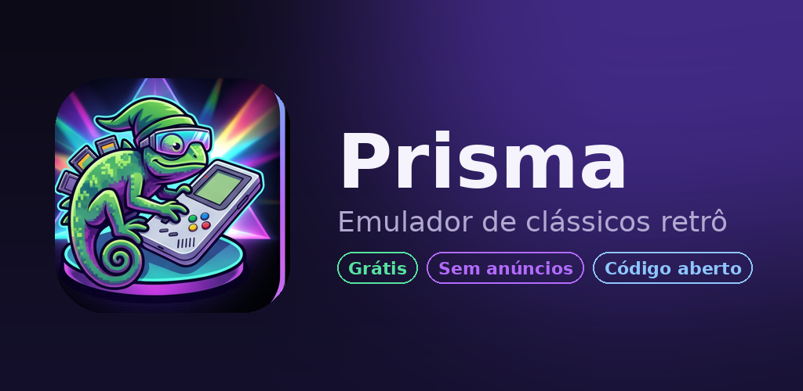
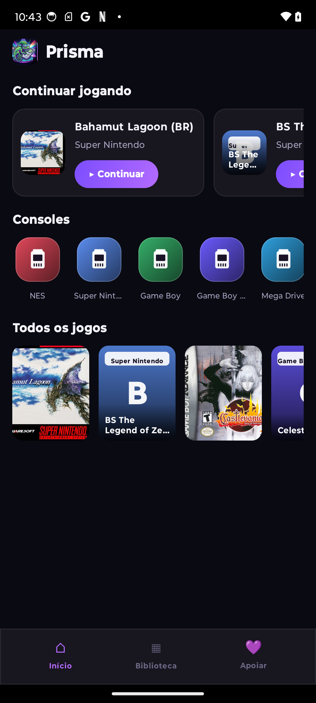
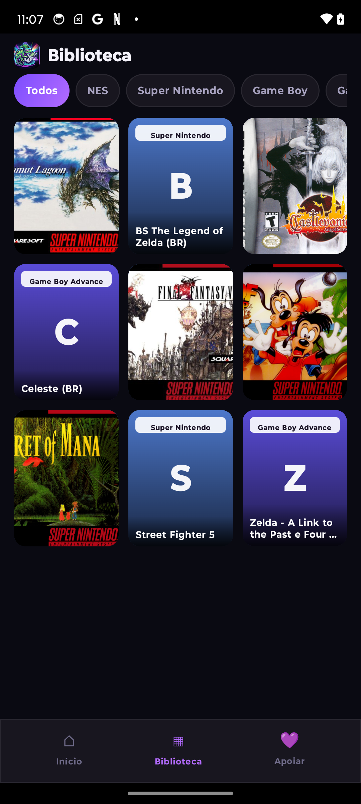
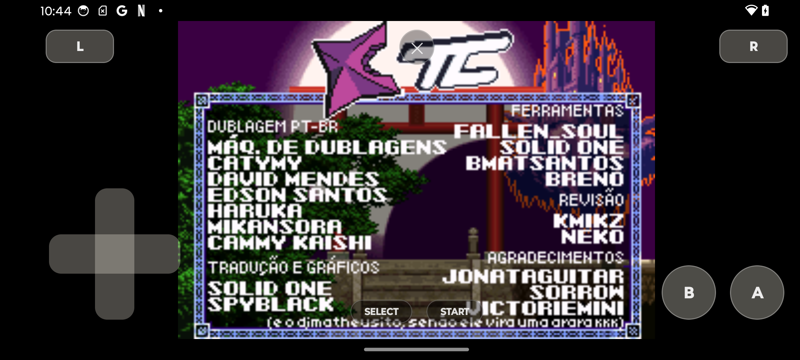

# Prisma



Emulador de clássicos retrô para Android, com **cara de console**: biblioteca com capas
automáticas, animação de cartucho entrando no console ao iniciar o jogo, e foco em
**rodar liso em celulares de hardware modesto**.

Grátis, sem anúncios, sem rastreio e **código aberto (GPLv3)**.
Você traz suas próprias ROMs — o Prisma não distribui jogos nem BIOS.


## Consoles suportados

Rodam **nativos**, sem depender de outros apps:

NES · Super Nintendo · Game Boy / Color · Game Boy Advance · Mega Drive / Genesis / Master System / Game Gear

## Recursos

- **Capas automáticas** — a biblioteca monta sozinha e baixa a arte dos jogos.
- **Continua sozinho** — salva o estado ao sair e você volta de onde parou.
- **Animação de abertura** — o cartucho entra no console de verdade do jogo (dá pra desativar no menu).
- **Controles na tela** adaptados a cada console (D-pad, A/B/X/Y, L/R, Start/Select).
- **Controle pelo celular** — use um segundo aparelho como controle, via QR, na mesma rede Wi-Fi.
- **Trocar capa** manualmente por uma imagem da galeria.
- **Desempenho** — cores leves e ajustes por core (ex.: idle optimization no GBA) para rodar liso.

<p>
  
  
  
</p>

## Como usar

1. Instale o app e abra.
2. Toque em **Escolher pasta de ROMs** e selecione a pasta onde estão seus jogos
   (via seletor do sistema — não precisa de permissão de "todos os arquivos").
3. A biblioteca monta sozinha e baixa as capas. Toque num jogo e **Jogar**.

## Privacidade

O Prisma **não coleta nenhum dado**: sem conta, sem anúncios, sem rastreadores.
Tudo (ROMs, saves, preferências) fica só no seu aparelho. A internet é usada apenas para
baixar as capas do banco público da libretro.
Detalhes: [Política de Privacidade](https://kurousagin.github.io/prisma/privacy.html).

## Build

Projeto Gradle padrão (AGP 8.5 · Kotlin · Jetpack Compose · JDK 17 · minSdk 31 · target 34).
Emulação via [LibretroDroid](https://github.com/Swordfish90/LibretroDroid), com cores libretro
embutidos em `app/src/main/jniLibs/arm64-v8a/`.

```bash
./gradlew assembleDebug        # APK de debug
./gradlew bundleRelease        # AAB assinado (requer keystore.properties — veja abaixo)
```

Para o build de release, crie um `keystore.properties` na raiz (ignorado pelo git):

```properties
storeFile=/caminho/para/sua.jks
storePassword=...
keyAlias=...
keyPassword=...
```

## Créditos e licenças

- **App Prisma** — GPLv3 (veja [LICENSE](LICENSE)).
- [LibretroDroid](https://github.com/Swordfish90/LibretroDroid) — GPLv3.
- Cores de emulação (fceumm, snes9x, gambatte, mGBA, genesis_plus_gx) pertencem aos
  respectivos projetos **libretro**, sob suas próprias licenças.

O Prisma é um projeto **sem fins comerciais**. Não inclui nem distribui ROMs ou BIOS —
use apenas jogos que você tem o direito de usar.

## Apoie

Grátis pra sempre. Se te ajudou, um Pix mantém o projeto vivo — a chave (Pix aleatória) está
na aba **Apoiar** do app.

## Contato

Dúvidas, bugs ou sugestões: [prismaemulator@gmail.com](mailto:prismaemulator@gmail.com)
ou pelas [Issues](https://github.com/Kurousagin/prisma/issues).
